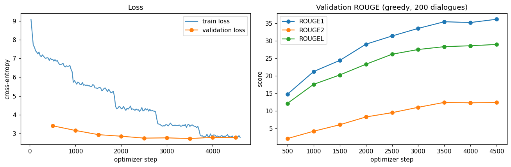
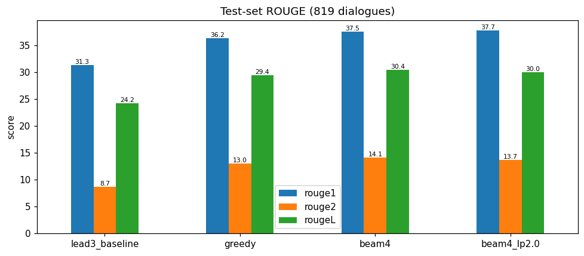
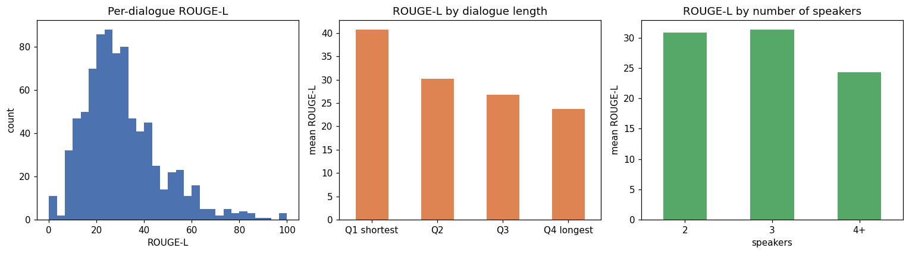

# Dialogue Summarization with a BERT-based Encoder-Decoder

Condensing messenger-style group chats into short, informative summaries using a pre-trained **BERT encoder** and **GPT-2 decoder**, fine-tuned on the **SAMSum** dataset.

**Contents:** [Problem](#1-problem-statement-and-business-context) · [Approach](#2-technical-approach-and-methodology) · [Results](#3-results-and-evaluation) · [Limitations and future work](#4-limitations-and-future-work) · [How to run](#5-how-to-run) · [Model weights](#6-model-weights) · [References](#7-references)

---

## 1. Problem statement and business context

Acme Communications users regularly come back to group chats with dozens of unread messages. Important details get lost: what was decided, when and where things happen, and who agreed to do what. Scrolling back is slow, and missed details lead to confusion and disengagement.

**Goal:** a proof of concept that reads a conversation and produces a one- or two-sentence summary a user can read in seconds, for example:

> **Chat:** Priya: we moved Friday's offsite to the downtown office because of the storm forecast … starts at 9:30 … Jenna can't make it before 11 …
> **Summary:** The offsite moved to the downtown office and starts at 9:30; Jenna will join at 11, so planning moves to after lunch.

Success means summaries that are accurate about people, times, and decisions, measurably better than a simple extractive baseline, and fast enough to generate on demand.

## 2. Technical approach and methodology

### Data
**SAMSum** (Gliwa et al., 2019): about 16k English messenger-style dialogues written by linguists, each with a human-written abstractive summary. Standard splits: ~14.7k train, 818 validation, 819 test.

Preparation (Section 1 of the notebooks):
- Normalized line endings and whitespace; converted placeholders such as `<file_photo>` into readable tags (`[photo]`); dropped empty records.
- Explored dialogue length, summary length, compression ratio, and number of speakers. Most chats are short two-person exchanges with a long tail of longer and multi-party chats; summaries are about 20 words and abstractive (third-person rewrites of first-person chat).

### Model
A warm-started Hugging Face `EncoderDecoderModel` (the "BERT2GPT" setup of Rothe et al., 2020):

```
dialogue ─► BERT tokenizer ─► BERT encoder (bert-base-uncased, 12 layers, pre-trained)
                                     │ contextual embeddings
                                     ▼
<|endoftext|> ─► GPT-2 decoder (gpt2, 12 layers, pre-trained + NEW cross-attention) ─► summary
```

- **Encoder:** BERT reads the whole conversation bidirectionally, so every message is encoded in context.
- **Decoder:** GPT-2 was pre-trained to generate fluent text left to right. Cross-attention layers connecting it to BERT are newly initialized and learned during fine-tuning.
- **Tokenization:** each half keeps its own tokenizer (BERT WordPiece for dialogues, GPT-2 BPE for summaries). GPT-2's `<|endoftext|>` serves as the start and end token. The final version adds a dedicated `[PAD]` token; in the MVP draft `<|endoftext|>` was also used for padding, which masked the start token during training (see Results).
- **Why GPT-2 rather than BERT as the decoder:** both satisfy the BERT-based requirement, but GPT-2 brings a pre-trained generator. The BERT2BERT variant runs by changing one config value (`DECODER_NAME = "bert-base-uncased"`).

### Training and optimization
| Setting | Value |
|---|---|
| Optimizer | AdamW, lr 1e-4 (MVP draft: 5e-5), weight decay 0.01 |
| Schedule | linear warm-up (10%) then linear decay |
| Batch | 8 × 2 gradient-accumulation steps = 16 |
| Precision | fp16 mixed precision |
| Padding | dynamic (per batch), labels masked with -100 |
| Max lengths | 512 input tokens, 128 summary tokens for training, 80 new tokens for generation |
| Epochs | up to 5, early stopping (patience 3 evaluations) |
| Model selection | best validation ROUGE-L, restored at the end |

Validation loss and ROUGE (on 200 held-out dialogues) are computed every 500 steps, with a checkpoint saved at each evaluation so Colab disconnects can be resumed.

### Evaluation
- **Metrics:** ROUGE-1, ROUGE-2, ROUGE-L, and ROUGE-Lsum (F1, with stemming), the standard SAMSum metrics.
- **Baseline:** Lead-3 (the first three chat lines).
- **Decoding:** greedy, beam search (4 beams, no repeated trigrams), and beam search with length penalty 2.0. The strategy is **selected on validation data** and then reported on the test set, so the test set is never used for tuning.
- **Statistical confidence:** 95% bootstrap confidence intervals over per-dialogue scores, including the paired difference against the baseline.
- **Error analysis:** scores by dialogue length and number of speakers, best and worst cases, and two factual-consistency heuristics: names in the summary that never appear in the chat (possible hallucinations), and recall of the participants the reference mentions.

### Challenges and how they were addressed
| Challenge | Resolution |
|---|---|
| Encoder and decoder use different vocabularies | Separate BERT and GPT-2 tokenizers, both saved with the model |
| GPT-2 has no pad or start token | `<|endoftext|>` as start and end token, a dedicated `[PAD]` token, and label padding masked with -100 |
| MVP draft model ignored the conversation (below the Lead-3 baseline; 95.5% invented names) | Diagnosed with factual-consistency checks; fixed the pad/start-token clash, raised the learning rate to 1e-4, trained on the full dataset |
| Local environment problems (Python 3.9.0 bug, `datasets` 4.x `Column` objects, CPU-only PyTorch, Jupyter hangs on Windows, a 4 GB GPU) | Python 3.11 environment, `list(...)` conversions, CUDA PyTorch build, single-process data loading on Windows, and Colab for the full run |
| Garbage output when special tokens were missing | Set start, end, and pad token IDs on the model config and generation config |
| Randomly initialized cross-attention | Learning-rate warm-up and full-dataset training |
| Saving failed on GPT-2's tied weights | Checkpoints in PyTorch format; final export tries safetensors and falls back automatically |
| Free-GPU memory limits and disconnects | fp16, dynamic padding, gradient accumulation, frequent checkpoints with resume |
| Tuning decoding on the test set would inflate scores | Decoding strategy selected on validation data |
| ROUGE ignores factual errors | Hallucinated-name and speaker-recall checks plus manual review |

## 3. Results and evaluation

### MVP draft (`notebooks/01_project3_mvp_draft.ipynb`)
Trained on 3,000 dialogues for 5 epochs (940 steps, 223 minutes on an NVIDIA GTX 1650 SUPER, 4 GB). Test set: all 819 dialogues.

| Method | ROUGE-1 | ROUGE-2 | ROUGE-L | Avg words |
|---|---|---|---|---|
| Lead-3 baseline | **31.34** | **8.68** | **24.21** | 23.6 |
| BERT→GPT-2, greedy | 15.02 | 2.02 | 12.53 | 24.4 |
| BERT→GPT-2, beam 4 | 16.70 | 2.47 | 13.11 | 23.7 |

**Finding:** the draft model learned the *form* of a summary (fluent, third-person, about the right length) but not the *content*. 95.5% of its summaries contained a name that never appears in the chat, and it mentioned the actual participants only 1.2% of the time. Likely causes were too little training for the randomly initialized cross-attention and a padding/start-token clash; both are addressed in the final version. Full numbers: [`results/mvp_test_results.csv`](results/mvp_test_results.csv).

### Final version (`notebooks/02_project3_final.ipynb`)

<!-- RESULTS:START -->
Trained on all 14,731 training dialogues for up to 5 epochs (4,605 steps, 44 minutes on a Tesla T4 in Google Colab). Test set: all 819 dialogues.

### Test-set results (819 dialogues)

| method | rouge1 | rouge2 | rougeL | rougeLsum | avg_words | ms_per_dialogue |
|---|---|---|---|---|---|---|
| lead3_baseline | 31.34 | 8.68 | 24.21 | 29.67 | 23.60 | 0.00 |
| greedy | 36.24 | 12.99 | 29.39 | 32.90 | 16.20 | 83.00 |
| beam4 | 37.49 | 14.09 | 30.42 | 34.02 | 15.30 | 136.10 |
| beam4_lp2.0 | 37.71 | 13.71 | 30.00 | 34.09 | 17.70 | 135.90 |

### Key findings

- Decoding strategy selected on validation: **beam4**. Test ROUGE-1 / ROUGE-2 / ROUGE-L = **37.49 / 14.09 / 30.42**.
- Versus the Lead-3 baseline (ROUGE-L 24.21): +6.21 ROUGE-L (95% bootstrap CI of the paired difference: +5.08 to +7.23).
- Generated summaries average 15.3 words; reference summaries average 20.0.
- By dialogue length, mean ROUGE-L is 40.7 on the shortest quartile and 23.7 on the longest.
- Two-speaker chats score 30.8 ROUGE-L; chats with 3+ speakers score 29.0.
- 49.5% of summaries contain a capitalized name not found in the dialogue (heuristic); speaker recall is 55.9%.
- Training took 44 min on Tesla T4 (14,731 training dialogues); the best checkpoint was at step 4500 (validation ROUGE-L 28.99).

### Figures







Example summaries: [results/sample_summaries.md](results/sample_summaries.md)
<!-- RESULTS:END -->

### MVP draft vs final version

| | Lead-3 baseline | MVP draft (beam 4) | Final (beam 4) |
|---|---|---|---|
| ROUGE-1 / ROUGE-2 / ROUGE-L | 31.34 / 8.68 / 24.21 | 16.70 / 2.47 / 13.11 | **37.49 / 14.09 / 30.42** |
| ROUGE-L vs Lead-3 | — | −11.10 | **+6.21** (95% CI +5.08 to +7.23) |
| Summaries with invented names | — | 95.5% | 49.5% |
| Speaker recall | — | 1.2% | 55.9% |
| Training data / time | — | 3,000 chats / 223 min (GTX 1650 SUPER) | 14,731 chats / 44 min (Tesla T4) |

Full outputs, including validation curves, the decoding-selection table, confidence intervals, and best and worst examples, are in [`notebooks/02_project3_final.ipynb`](notebooks/02_project3_final.ipynb). Example summaries for new Acme-style chats are in [`results/sample_summaries.md`](results/sample_summaries.md).

### Interpretation
- **Against the baseline:** the final model beats Lead-3 by 6.2 ROUGE-L, and the 95% bootstrap interval of the paired difference (+5.1 to +7.2) excludes zero, so the gain is not sampling noise. It writes abstractive third-person summaries, often exactly right for short chats ("Natalie's wallet is in her room.").
- **What fixed the MVP draft:** a dedicated `[PAD]` token, a higher learning rate, and 5× more training data took ROUGE-L from 13.1 to 30.4 and turned a model that ignored the conversation into one that reads it.
- **Where it struggles:** long chats (ROUGE-L 40.7 on the shortest quarter vs 23.7 on the longest) and, to a lesser degree, chats with three or more speakers (29.0 vs 30.8).
- **Trustworthiness:** names are the main weakness. Half the summaries contain a name not in the chat (Richie and Clay became "Barry and Phil"), and the demo changed a 9:30 start to 8:30. ROUGE barely penalizes these errors, but users would notice them first.

## 4. Limitations and future work

### Limitations
- **Input length:** BERT's 512-token limit truncates very long group chats.
- **Cross-attention from scratch:** purpose-built seq2seq models (BART, PEGASUS) pre-train these layers and typically score higher on SAMSum.
- **Metric blind spots:** ROUGE measures word overlap, not correctness; the factual checks are heuristics.
- **Domain gap:** SAMSum is clean English written by linguists; real chats include slang, emojis, typos, several languages, and threads that span days.
- **Name handling:** `bert-base-uncased` lowercases names and splits unusual ones into fragments, and GPT-2 must re-spell them in a different vocabulary with no way to copy from the chat. Common names survive; rare ones are replaced (49.5% of summaries contain an invented name). Numbers and times are not always copied faithfully either.
- **Short summaries:** 15 words on average versus 20 in the references.
- **Single run:** results come from one seed; variance across seeds was not measured.

### Future work
1. Fix name handling: use `bert-base-cased` as the encoder, and compare with `facebook/bart-base`, whose shared vocabulary makes copying names and numbers easier.
2. Track speaker recall during training alongside ROUGE.
3. Compare with BERT2BERT.
4. Tune learning rate, beam size, and length penalty on validation data (a length penalty would also address the short summaries); repeat the best setup over several seeds.
5. Handle long chats by chunking and summarizing hierarchically, or by using a long-input encoder.
6. Add an entailment-based factual-consistency filter before showing summaries to users.
7. Run a human evaluation with Acme users that rates usefulness and correctness.

### Connection to the business problem
The prototype shows the feature is feasible: built from free, pre-trained components and trained in 44 minutes on a free GPU, it beats the extractive baseline and often produces correct one-line summaries that let users catch up in seconds, addressing Acme's information-overload problem. It is not yet ready for users, though: wrong names and changed times are exactly the errors that would mislead people in a messaging app, so fixing name handling comes before any rollout. A responsible rollout would label summaries as AI-generated, link each summary back to the original messages, start with "catch up on unread messages" in smaller groups where the model is strongest, and track user corrections as a quality signal.

## 5. How to run

### Google Colab (recommended)
1. Open `notebooks/02_project3_final.ipynb` in Colab and select **Runtime → Change runtime type → T4 GPU**.
2. Run this in a new cell at the top first, so the notebook can find the repository folders and update this README:
   ```bash
   !git clone https://github.com/bowers261/DS_Capstone.git
   %cd "DS_Capstone/Project 3 Dialogue Summarization/notebooks"
   ```
3. Optional flags in the configuration cell:
   - `USE_SUBSET = True` for a quick 20–30 minute run on 3,000 dialogues (the default trains on the full set, roughly 1–2 hours on a T4).
   - `USE_GOOGLE_DRIVE = True` to keep checkpoints on Drive across disconnects.
   - `PUSH_TO_HUB = True` and `HUB_REPO_ID` to publish the weights.
4. **Runtime → Run all.**

### Local
```bash
pip install -r requirements.txt
jupyter notebook notebooks/02_project3_final.ipynb
```
A CUDA GPU is strongly recommended; CPU training is impractically slow. For reference, the MVP draft's 3,000-dialogue run took 3.7 hours on a 4 GB GTX 1650 SUPER. On Windows, use Python 3.10 or later (Python 3.9.0 and 3.9.1 have a `typing` bug that breaks `datasets`).

### Summarizing new chats with the trained model
```bash
# from a local model folder
python inference.py --model models/bert2gpt2-samsum-v2 --file chat.txt

# the MVP draft's model, for comparison
python inference.py --model models/bert2gpt2-samsum-final --file chat.txt

# from the Hugging Face Hub
python inference.py --model <your-username>/bert2gpt2-samsum --file chat.txt
```
`chat.txt` holds one message per line in `Name: message` format. Use `--beams 1` for faster greedy decoding.

### Repository structure
```
DS_Capstone/Project 3 Dialogue Summarization/
│
├── README.md                                  Project report and run instructions (this file)
├── inference.py                               Command-line summarizer for a saved model
├── requirements.txt                           Python dependencies
├── .gitignore                                 Keeps checkpoints and model weights out of Git
│
├── notebooks/
│   ├── 01_project3_mvp_draft.ipynb            MVP draft: 3,000 dialogues, local GPU, executed with outputs
│   └── 02_project3_final.ipynb                Final version: [PAD] fix, lr 1e-4, full dataset
│
├── docs/
│   └── Dialogue Summarization Pitch.pdf       Project pitch report
│
├── figures/                                   Plots saved by the final notebook
│   ├── data_overview.png                      Dialogue/summary lengths, speakers per chat (Sec. 1)
│   ├── training_curves.png                    Train/validation loss and validation ROUGE (Sec. 4)
│   ├── test_rouge.png                         Test ROUGE: baseline vs. decoding strategies (Sec. 5)
│   └── error_breakdown.png                    ROUGE-L by dialogue length and speaker count (Sec. 6)
│
├── results/
│   ├── mvp_test_results.csv                   MVP draft test-set ROUGE, length, and speed
│   ├── test_results.csv                       Final test-set ROUGE, length, and speed (Sec. 5.2)
│   ├── decoding_selection_validation.csv      Decoding strategies scored on validation (Sec. 5.1)
│   ├── key_findings.md                        Auto-generated findings, copied into this README
│   └── sample_summaries.md                    Demo chats and SAMSum test examples (Sec. 7)
│
├── models/                                    NOT committed (≈1 GB each; see "Model weights")
│   ├── bert2gpt2-samsum-final/                MVP draft model
│   └── bert2gpt2-samsum-v2/                   Final model
│       ├── config.json
│       ├── generation_config.json
│       ├── model.safetensors                  (or pytorch_model.bin)
│       ├── encoder_tokenizer/                 BERT tokenizer for dialogues
│       ├── decoder_tokenizer/                 GPT-2 tokenizer for summaries
│       └── log_history.json                   Training and evaluation log
│
└── checkpoints/                               NOT committed: intermediate training checkpoints
```
Files under `figures/` and the final-run files under `results/` are created when `02_project3_final.ipynb` is run.

## 6. Model weights

The fine-tuned model has about 260M parameters (roughly 1 GB), which exceeds GitHub's file-size limit, so it is not committed to this repository. Two options:

- **Download:** if published, the weights are on the Hugging Face Hub at `<your-username>/bert2gpt2-samsum` and load with `inference.py` as shown above.
- **Reproduce:** run the notebook end to end with the default configuration (seed 42). The final model is saved to `models/bert2gpt2-samsum-v2/` together with both tokenizers and the training log. The MVP draft's model is in `models/bert2gpt2-samsum-final/`.

## 7. References

- Gliwa, B., Mochol, I., Biesek, M., & Wawer, A. (2019). SAMSum Corpus: A Human-annotated Dialogue Dataset for Abstractive Summarization. *Workshop on New Frontiers in Summarization.*
- Devlin, J., Chang, M.-W., Lee, K., & Toutanova, K. (2019). BERT: Pre-training of Deep Bidirectional Transformers for Language Understanding. *NAACL.*
- Radford, A., Wu, J., Child, R., Luan, D., Amodei, D., & Sutskever, I. (2019). Language Models are Unsupervised Multitask Learners. OpenAI.
- Rothe, S., Narayan, S., & Severyn, A. (2020). Leveraging Pre-trained Checkpoints for Sequence Generation Tasks. *TACL.*
- Lin, C.-Y. (2004). ROUGE: A Package for Automatic Evaluation of Summaries. *Text Summarization Branches Out.*
- Lewis, M., et al. (2020). BART: Denoising Sequence-to-Sequence Pre-training for Natural Language Generation, Translation, and Comprehension. *ACL.*
- Wolf, T., et al. (2020). Transformers: State-of-the-Art Natural Language Processing. *EMNLP: System Demonstrations.*
- Dataset source used: [`knkarthick/samsum`](https://huggingface.co/datasets/knkarthick/samsum) on the Hugging Face Hub.
